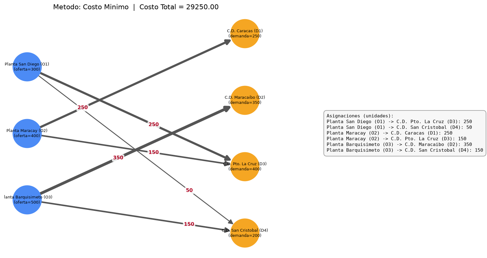
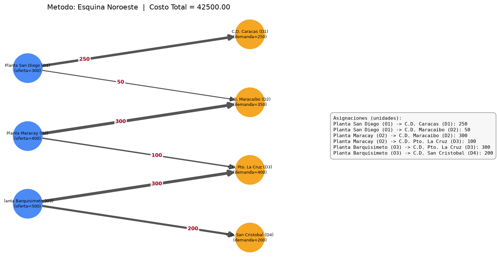
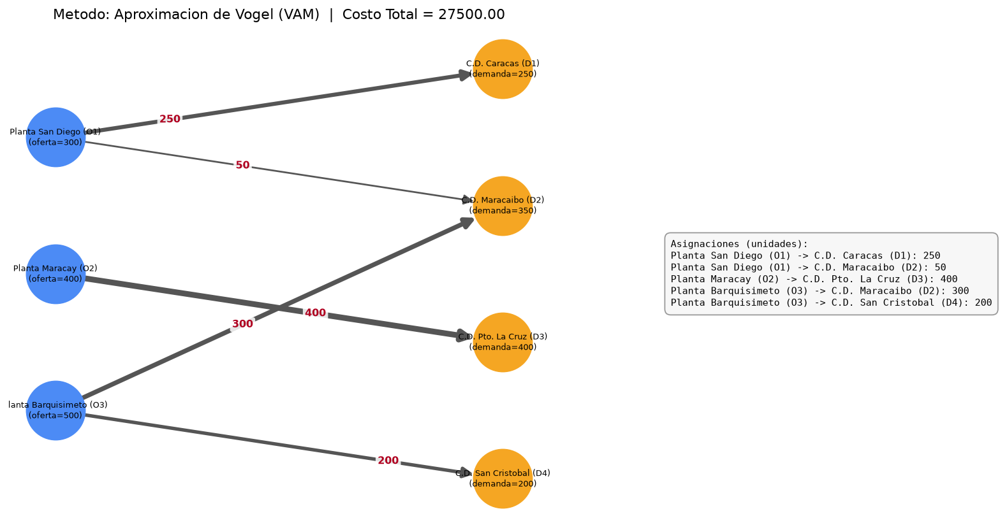

# Tarea de Optimización de Redes de Transporte con Integración de Inteligencia Artificial
## Integrantes
**Miguel Maestre y Mauricio Maestre** 

## Ejecución del Programa

Desde la carpeta raíz debe usar python main.py y al usar el menú interactivo seleccione opción 11 para ver la salida con los datos del enunciado

## Salida del Programa
  

## Grafos generados para los métodos de esquina noroeste, vogel y costo mínimo

  